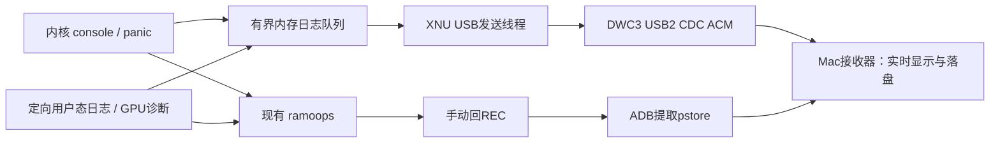

# Pong USB 日志读取方案

状态：设计稿，尚未实现 XNU USB 日志驱动。基于当前 v110 启动路径审阅；本方案不改变正在运行的手机。

## 1. 目标与选型

主通路采用 **XNU 原生 DWC3 设备端 + USB 2.0 CDC ACM + Mac 日志接收器**。手机启动到内核 USB 驱动就绪后，电脑持续接收日志；USB 尚未就绪的早期日志从内存补发。现有 ramoops / REC ADB 保留，用于 USB 失效或内核卡死后的上一轮日志读取。



CDC ACM 将设备侧 USB 传输呈现为主机串口，适合连续文本日志。规范与实现参考：[Linux gadget serial 文档](https://docs.kernel.org/usb/gadget_serial.html)、[Apple USBCDC 驱动源码](https://github.com/apple-oss-distributions/AppleUSBCDCDriver)。Linux 的 gadget 框架仅作协议参考；XNU 仍需自己的设备端实现。

## 2. 已确认的项目现状

| 项目 | 当前事实 | 对方案的影响 |
| --- | --- | --- |
| XNU USB | 当前 `drivers/` 没有已接入的 DWC3 设备端/CDC 日志模块 | 不能仅增加启动参数就获得 XNU ADB 或 USB 串口 |
| UEFI USB | `uefi-pong/Platforms/Xiaomi/mondrianPkg/Include/DXE.inc` 包含 `UsbfnDwc3Dxe`、`UsbDeviceDxe`、`UsbConfigDxe` 等二进制模块 | 可以作为固件阶段的初始化线索；不代表 XNU 已有 USB 支持 |
| 内核日志入口 | `osfmk/console/serial_console.c` 的 `console_write()` 和 `console_write_unbuffered()` 已镜像到 ramoops | 可在同一层增加非阻塞日志入队，不依赖屏幕是否已交给 iOS |
| 持久日志 | `pong_ramoops_console.h` 使用 `0x85200000` 起始的 4 MiB 保留区，console 与 diagnostic/pmsg 各 2 MiB | 保持 Linux 兼容的 12 字节头及区域划分，不能把 USB 元数据塞进其头部 |
| 用户态日志 | 已有 `kern.pong_diagnostic`；`applog_name` 对服务日志定向选择 | 首版覆盖 backboardd、SpringBoard、Preferences、launchd 退出原因与 GPU 诊断；不能宣称已捕获所有 unified log |
| Sheng USB 读日志 | `package/linux-log/init` 在独立 Linux 中以 CDC ACM 提供 shell，读取 userdata 尾部日志；`scripts/read-sheng-log.py` 在主机取回 | 是重启后的读取方案，不是 XNU 运行时 USB 实时日志；其 SM8550 启动镜像及 userdata 尾部布局不能直接用于 Pong |
| 启动参数 | v110 的构造参数长 594 字节，DarwinBoot22 当前命令行区域为 608 字节 | 只新增 `usblog=1`，连同空格为 603 字节；其余设置放入 ADT/编译配置，打包时保留字符串结束字节 |

UEFI USB 协议属于固件环境，XNU 接管后不能继续调用已结束的 Boot Services 驱动。控制器所有权、DMA、事件缓冲区必须交给内核自己的实现。[UEFI Boot Services 说明](https://uefi.org/specs/UEFI/2.10/07_Services_Boot_Services.html)

## 3. Pong 板级资源与驱动边界

以下是本机 `uefi-pong/Resources/DTBs/pong.dts` 中的资源线索，编码实现前需与匹配 Pong 的实际 DT/原厂驱动核对，不能用 Sheng 或其他平台的默认值代替：

| 资源 | 本机 DT 内容 |
| --- | --- |
| 控制器 | `ssusb@a600000`，父资源大小 `0x100000` |
| DWC3 core | `dwc3@a600000`，资源长度 `0xd93c` |
| Core 中断 | `<0 0x85 4>`，即 SPI 133；GIC INTID 为 165，不是 INTID 133 |
| USB2 PHY | `hsphy@88e3000`；另有 EUD 与 repeater 依赖 |
| USB3 PHY | `ssphy@88e8000`；首版限制 USB2，避免引入 SuperSpeed / DP combo PHY 启动链路 |
| DMA/IOMMU | `iommus = <0x5b 0 0>` 指向应用侧 SMMU；DT 标注 `dma-coherent` |
| 电源/时钟 | `USB3_GDSC`，core / iface / bus_aggr / utmi / sleep 时钟，core reset，以及 PHY 电源/复位依赖 |

首版使用独立小型设备端驱动，不以 Apple USB family 或 iOS usbmux/lockdown 服务作为先决条件。主要工作：

1. 识别 Type-C/VBUS 和 device 角色；采用匹配 Pong 的电源、时钟、USB2 PHY/repeater 初始化顺序。
2. 明确结束旧固件 USB DMA，独占 DWC3；切换到 High Speed 设备模式并重新枚举，允许主机出现一次断连。
3. 完成 EP0 标准请求、CDC descriptors 与 class requests：`GET/SET_LINE_CODING`、`SET_CONTROL_LINE_STATE`。波特率是兼容串口 API 的设置，实际数据经 USB bulk 传输。
4. 提供 CDC 通信/数据接口、通知 IN 和数据 bulk IN/OUT。OUT 首版仅承载日志读取/续传控制，不提供交互 shell。
5. 事件缓冲区、TRB 和 TX 缓冲区使用内核拥有的固定内存；DMA 使用正确 IOVA，不把内核 VA 当总线地址。采用当前 4 KiB 页面映射，并处理实际一致性和内存屏障。
6. USB 使用自己的 SMMU 映射与上下文分配；不能重置共享的应用侧 SMMU，也不能抢占 UFS/显示等已使用的 context bank。DT 的 coherent 标记不能替代实际 DMA 映射和同步。
7. 首版可在独立线程中有界轮询事件，避免马上依赖新 IRQ 路径；硬件命令仍必须有超时和退出路径。之后接入现有 GIC SPI 提供者。

当前 ADT 脚本已有说明：不完整的 `interrupts`/父控制器描述会使早期 IODT 中断解析循环。USB 的 ADT 元数据必须与实际提供者一同接入，不能只添加标准 `interrupts` 属性。

## 4. 日志生产与发送分离

### 日志生产路径

- 复用现有 console 与 diagnostic 入口，将同一批字节写入普通内存队列；不在 `printf`、异常处理或持锁路径执行 USB I/O。
- 队列暂定 1 MiB，固定预分配。单次写入分成有界小块，尝试一次抢占写入权；竞争、递归或队列满时计数并返回，不自旋等待、不分配内存。
- 元数据/原子变量放在普通 RAM；既有 ramoops 区继续按原有映射和 Linux 格式写入。
- 不依赖 UFS 写入、APFS、Data 挂载、launchd、SpringBoard、GPU 或显示初始化。已关闭屏幕文字输出也不关闭日志缓存。
- 已有 console/diagnostic 内容可在 USB 就绪后补发。读取由记录器提供的一致性快照，保留原始字节；不能并发解析变化中的环形头后直接猜测数据顺序。

### USB 发送路径

- 单独内核线程从队列取出数据，复制到固定 TX 缓冲区，再提交 bulk IN。USB DMA 不直接引用会被生产者覆盖的环形队列。
- 每批上限暂定 16 KiB，低流量等待上限暂定 20 ms；这是设计配置，不是实测性能承诺。
- 未插 USB、Mac 尚未打开串口、对端停止读取或拔线时，发送线程退避；内核正常启动与日志生产继续。
- 环形覆盖、生产者竞争丢弃、USB 重连分别记录计数；主机明确显示缺口，不把收到的片段标为完整日志。
- 断连后的缓冲区回收必须等待控制器结束 DMA，不能在未确认完成时释放物理页。

### Panic 路径

真实 panic 处理保留。首先写现有持久 RAM；仅尝试非阻塞日志入队，不在 panic 中重置 USB、等待枚举或持有普通驱动锁。若发送线程仍能运行，尾部日志可能实时到达；若内核/USB 已停止，后续由 REC 取回。不能保证严重硬锁死时实时 USB 仍可工作。

ramoops 依赖 RAM 跨重启保留，断电或固件清内存可能丢失内容；这是后备通路的实际边界。[ramoops 文档](https://docs.kernel.org/admin-guide/ramoops.html)

## 5. 传输格式与 Mac 接收器

首版 CDC 上使用简单分帧字节流，Mac 接收器负责解码为原始文本；不要求人在终端手动操作协议。

帧头暂定 40 字节、小端：`magic[8] + channel:u8 + flags:u8 + version:u16 + boot_id:u64 + sequence:u64 + uptime_us:u64 + length:u32`。`length` 最大 16 KiB，payload 保留原始日志字节，允许非 UTF-8 和中途截断的字符。`magic` 为 `PNGLG001`，`version=1`。

通道：metadata、console、diagnostic、heartbeat、panic。`boot_id` 仅作为启动分段标识，不作为安全凭证。序号及丢失计数支持识别重传与缺口；早期补发需标记 replay，不把补发时间伪装成原始事件时间。

拟新增 `scripts/read-pong-usb-log.py`，功能：

- 按调试设备的 VID/PID、USB 序列号匹配串口；不照搬 Sheng 中直接选择第一个 `/dev/cu.usbmodem*` 的做法。
- 自动等待、打开、识别 UEFI→XNU 或重启导致的重新枚举；同一启动按序号续读，换 `boot_id` 创建新目录。
- 实时打印可读日志，并保存原始流、`console.log`、`diagnostic.log`、`events.jsonl` 和会话元数据。
- 日志接收与界面打印分离，避免终端速度拖慢 USB 接收；定期落盘，断连时保留已收到内容。
- 启动时接收能力/版本说明与可回放的序号范围；请求的旧日志已被覆盖时报告缺口，继续取可用数据。
- 使用长度、序号和版本做必要的协议解析，不进行镜像哈希、镜像审计、设备镜像回读或基准测试。

预期使用方式，**以下脚本尚未实现**：

```text
python3 scripts/read-pong-usb-log.py --serial "$ADB_SERIAL" --out build/usb-logs
```

## 6. 用日志判断卡住的范围

每秒发送一个轻量状态记录，分别带上：设备 uptime、现有启动阶段、内核心跳计数、USB worker 计数、已输出字节数、丢失记录数。阶段只是最后一个里程碑，不代表当前线程所在位置。

| 现象 | 可以得出的结论 |
| --- | --- |
| 阶段不变，但内核心跳、USB worker 计数持续增加 | 至少部分内核调度与 USB 通路仍在运行；启动流程可能等待/阻塞，不能仅据此断言是性能问题 |
| USB 状态继续到达，但业务日志长期不变 | 读取对应服务/线程的阻塞点；可进一步加入独立的用户态心跳 |
| 明确收到 panic | 保存尾部记录及启动标识，之后用 REC 补取持久日志 |
| USB 流停止或断连 | 可能是线缆、控制器、驱动、调度或整机故障；单凭静默不能认定整机卡死，转 REC 后备通路 |

## 7. 按可交付结果推进

### 第一阶段：自动提取 REC 既有日志

先做主机侧自动等待 REC、立即复制 `/sys/fs/pstore` 的工具，减少每轮人工操作。此通路目前已有工作基础；只提供重启后的日志，不冒充实时流。

当前可手动使用：

```sh
adb -P 5038 -s "$ADB_SERIAL" pull /sys/fs/pstore ./pong-pstore
```

保存 console 与 pmsg 原始文件，按会话目录归档；不删除 pstore 文件，不读取/校验设备镜像。

### 第二阶段：XNU 原生 USB2 CDC 日志

新增 `drivers/PongUsbLog/`，实现板级准备、DWC3 设备端、CDC、固定队列及发送线程；在 IOKit/内存可用后启动。新增 `scripts/build-pong-usblog-platform.py`、编译开关、ADT 节点及 `usblog=1` 接线。失败有界返回，继续 iOS 正常启动。

首个交付结果是主机可枚举调试串口，收到启动标识、早期日志补发和持续内核日志。不同时加入网络、usbmux 或完整 ADB 服务。

### 第三阶段：用户态诊断与中断路径

接入已有定向服务日志、退出原因、GPU/Settings 诊断，完成主机自动重连与续传，再将事件轮询切换为已绑定提供者的 IRQ 驱动。

### 后续可选：固件阶段日志

UEFI 侧可以单独使用 UsbfnIo 发送固件日志，但 ExitBootServices 前必须结束固件 DMA。XNU 重新枚举后按同一启动标识合并会话。最早期内核日志优先通过 RAM 补发，不先改动曾反复出现 early-console 回归的初始化路径。

## 8. 完成标准与当前边界

实施完成后的判定标准包括：断线不阻塞启动；晚接电脑能收到保留范围内的早期日志；屏幕进入图形界面后日志继续；可分离 kernel/diagnostic 记录；重连与溢出有明确记录；panic/硬锁死后仍可从 REC 提取已有持久日志。

这些是后续实施的判定标准，本次未编译、临时启动或执行测试。当前产出仅为方案与源码依据，XNU 实时 USB 通道仍待实现。
