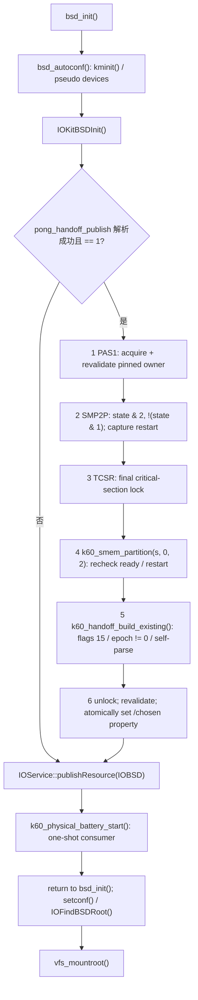

# ADSP handoff 集成顺序

> 2026-11-15；离线集成交付。0617 保留在 feat/adsp-handoff-owner，暂不并 main。真实 PAS1 provider 与最终调用点由 Lead/ADSP、charger 线共同评审；本文不证明 ADSP、音频或电池链路可用。

调用前置条件见 [HANDOFF-PUBLISH.md 的调用点契约](HANDOFF-PUBLISH.md#调用点契约)。本轮只给现有 0617 候选钩子加默认关闭的门控，不改 provider、SMEM 算法、0614 或补丁顺序，不生成内核或镜像，不接触设备。

## Boot 时间轴

下图是本分支候选路径，不是已合入 main 的时序。所有六步均须在同步调用返回前完成或失败退出；失败不发布属性，随后允许原有启动流程继续。

default-off gate 在 IOKitBSDInit() 内、任何交接调用之前读取；局部变量初始化为 0，只有 PE_parse_boot_argn() 返回成功且值精确等于 1 才进入发布器。

六步主线：PAS1 → SMP2P ready/non-reset → 最终 TCSR 临界区 → SMEM partition → existing-only build → 解锁后写 /chosen。图中省略了各步失败到 IOBSD 的边：任一步失败都必须停止本次交接，不能伪造成功后继续下一步。

**锁的实际嵌套边界：** 第 2 步的 ready() 为读取 item 443，已经短暂执行 lock → k60_smem_partition → k60_handoff_remote_ready → unlock；读取前绝不是无锁。第 3–5 步是第二段最终临界区，第 6 步发布前还会重复一次带锁的 ready discovery。不得为迎合箭头顺序而把首次 SMEM 读取挪到锁外，也不得带着同一个不可重入 TCSR 锁调用 k60_handoff_publish()。

## 六步的函数前后界限

| 步骤 | 当前分支函数/责任 | 必须在其后发生 | 必须在其前完成 |
|---|---|---|---|
| 1 PAS1 | k60_adsp_handoff_publish() 先验证板级范围、重复属性并预分配 OSData，再调用 k60_adsp_owner_acquire()/revalidate()。Owner 须在 DSP stopped 时准备新 FIFO，认证/启动 PAS1，持续持有资源与排他 token。 | opt-in 门控成功；早期固件载体及资源 provider 已可用。 | runtime 映射 SMEM/TCSR、ready() 及所有后续步骤；绝不能等 rootfs 提供 ADSP 固件。 |
| 2 SMP2P | k60_handoff_publish() 的 o->pas、o->ready；runtime ready() 在短锁内查 partition 和 item 443，要求 slave-kernel 的 (state & 2u) != 0 且 (state & 1u) == 0，保存 restart。 | 真实 owner 成功且被 pin；合法映射已建立。 | 第 3 步最终锁；超时/失配时不 build、不 publish。 |
| 3 TCSR | 发布器调用 o->lock(ctx)，runtime lock() 有界取得硬件 mutex。调用者提供回调，builder 自身不锁。 | 第 2 步 ready 成功；上一次 discovery 已解锁。 | 第 4 步读分区、fresh descriptor 检查及第 5 步 existing-only build。 |
| 4 SMEM partition | k60_smem_partition(s, 0, 2, &part)；在锁内复核 ready/restart、32 字节全零 descriptor 和既有 items。 | 第 3 步锁成功。 | 构造 K60HandoffPlan / 调用 build；失败的所有 acquired-lock 路径均解锁。 |
| 5 build | k60_handoff_build_existing()，随后 k60_adsp_handoff_parse()，核对 desc/TX/RX 精确 32/4096/4096。plan.required == K60AdspHandoffRequired == 15；epoch 非零且属于同一 pinned owner。 | 第 4 步有效；临界区仍保持。 | o->unlock(ctx)；不得调用 allocating builder、清零活环或重置索引来修饰失败。 |
| 6 /chosen | 先 unlock，再复核 owner 和 ready/restart；追加精确 104 字节、再次自解析，runPropertyAction 原子检查重复并 setProperty。成功后不 abort owner。 | 第 5 步成功、TCSR 已释放。owner callback、等待和 registry commit 都不得夹在第 3–5 步锁内。 | 发布器同步返回，然后 publishResource(IOBSD)、k60_physical_battery_start()；因此也早于 setconf()/IOFindBSDRoot()/vfs_mountroot()。 |

ready() 每轮 polling 最多 2000 ms、间隔 20 ms；每次 TCSR lock 最多 1000 us、重试间隔 10 us。ready 会被多次调用，不能把单次 polling 上限误写成整个交接全局只耗时 2 秒。每次 sleep 前已解锁。TCSR 只串行化主机 SMEM 访问，不会冻结 DSP；restart 复核不能保证未来不崩溃。

## 电池入口与 root 挂载的边界

- inspected XNU 路径是 bsd_init() → bsd_autoconf() → IOKitBSDInit()，返回 bsd_init() 后才 setconf()/IOFindBSDRoot() → vfs_mountroot()。因此选定的六步都位于 root 挂载之前，普通 rootfs/Data 文件读取不能充当前置固件载体。
- 本分支 k60_physical_battery_start() 先置 attempted，再读取 /chosen/k60-adsp-glink-handoff；无属性或解析失败就返回，不会为晚到的属性自动重试。异步派发、vfs_mountroot 之后或 Data-mount 钩子不能补救本次启动。
- 这只说明现有 consumer 代码要求的时序，不说明真实 provider/consumer 已完成集成。当前默认 owner 返回 -1000，在 runtime 的 SMEM/TCSR 映射前失败；成功日志或合法 blob 都不是 GLINK 通信/电池读数证明。
- 启用早期试验会取得不可回收的 startup owner=1 claim，即使随后失败也排斥晚期诊断 owner=2。门控必须放在调用发布器之前，不能先 claim、map、ready 再检查参数。参数关闭时，晚期诊断保持其原有门控行为。

## 默认关闭和宿主断言

0617 的 IOKitBSDInit() 候选调用点仅在 XNU 的 PE_parse_boot_argn() 返回成功且写入的 unsigned 值等于 1 时调用 k60_adsp_handoff_publish()；这里检查解析结果，不要求原始 token 字面恰为 pong_handoff_publish=1。检查的 XNU parser 会把裸 pong_handoff_publish 视为 1，四字节输出还会截断较大数值，例如 4294967297 也会写入 1。缺参、解析失败（即使 parser 向输出写了 1），或解析结果为 0、2、UINT32_MAX 均不调用发布器。XNU_K60_PHYSICAL_BATTERY=0 时连参数解析都被编译掉。未修改 board.toml 默认参数或镜像参数白名单；未来若要制作 opt-in 镜像，应先由 Lead 审查登记参数，再走规范镜像 gate，不得绕过白名单。

[test-k60-handoff-integration.py](../../../scripts/tests/test-k60-handoff-integration.py) 将 0617 以 fuzz=0 应用到临时 predecessor fixture，提取**应用后的真实 IOKitBSDInit() 函数体**，分别按电池宏 0/1 编译运行。7 场景 × 2 配置 = 14 项：关闭路径的发布器调用、SMEM/TCSR/PAS/startup claim 计数均为 0；开启路径会触达这些 spy，证明断言不是空跑，并检查 publisher → IOBSD → battery 顺序；provider 返回 -1000 也不会阻断原有 IOBSD/battery 调用顺序。

宿主 fixture 替代了 parser；14 项证明解析返回值到调用点的分派行为，不覆盖原始 boot-string 的解析。这里证明的是新增交接调用点不会进入任何 downstream 交接访问，spy 不执行硬件访问。它不是“整个 boot 的其他模块都不访问 SMEM”的证明：已有 /chosen 属性的电池 consumer 或另行启用的旧诊断仍属于各自策略；也不是硬件 tracer、完整内核链接或整条 series replay。缓存中的旧 late hook 与本分支 0614 不同，fixture 的 late 段按当前 0614 postimage 重建。

宿主记录：E:/k60-work/artifacts/adsp-handoff-optin-20261115/integration.log；SHA-256 b8118e6bc6d1f9e537c72e96706d519007b96955f507c5b33a3c063fef3e30d7。结果：14 项宿主场景、5 个补丁段、3 个 canonical mirrors 均通过。没有运行 build-strict、内核编译/链接、生成镜像或设备/串口操作。

## 未来集成者检查清单

- [ ] 0617 仅留试验分支；与真实 PAS1 provider、charger consumer 一起评审。0618 留给 springboard，不能重编号/覆盖他线补丁。
- [ ] 核对目标 XNU 的 bsd_init/bsd_autoconf/IOKitBSDInit/setconf 调用顺序，确认六步早于一次性电池入口及 vfs_mountroot；provider 不依赖未挂载的 root/Data。
- [ ] 所有到 k60_adsp_handoff_publish() 的试验入口均经过默认 0、parse-success 且精确 ==1 的 gate；无旁路调用；没有静态初始化、预读 SMEM 或提前 claim。
- [ ] 先证明真实 PAS1 认证、固件装载、持续资源和排他 token/epoch；flags=15/epoch!=0 只是必要数据条件，不能冒充所有权。
- [ ] 第 2 步 discovery 的短锁、第 3–5 步最终锁和第 6 步复核短锁均完整配对；无 provider callback、OSData 分配、registry commit 或 sleep 位于最终锁内。
- [ ] item 443 的 ready/non-reset 和 restart 一致，host0/ADSP2 partition 与 478/479/480 几何完全匹配；拒绝缺项/脏 descriptor/已进展环，不现场分配或清零。
- [ ] plan.required 精确 15、epoch 非零绑定本次启动和配置；build_existing 与 consumer self-parse 对同一 104 字节通过。
- [ ] 成功属性在 IOBSD/battery 前原子可见；失败不发布；成功后不 abort/reset/释放 provider；确认早期失败排斥晚期 owner 的行为可接受。
- [ ] 重跑宿主关闭路径零访问、开启路径可达、失败路径顺序和 0617 canonical mirrors/fuzz=0 检查；后续完整内核链接/镜像核验单独记录，不能沿用本次宿主结果。
- [ ] 只有用户和 Lead 明确授权后才 boot；以真实 PAS1、持续资源、SMP2P、consumer 发现及 GLINK 报文证据判定集成，不能仅凭发布日志。

## 本次检查的源码定位

- 本分支 [0617 调用点补丁](../../../patches/xnu/0617-k60-adsp-glink-handoff.patch)、[K60HandoffRuntime.cpp](../../../drivers/PongPower/K60HandoffRuntime.cpp)、[K60HandoffPublish.c](../../../drivers/PongPower/K60HandoffPublish.c)、[K60HandoffBuild.c](../../../drivers/PongPower/K60HandoffBuild.c)、[K60Battery.cpp](../../../drivers/PongPower/K60Battery.cpp)。
- 只读缓存位于 /opt/k60/trees/k60build/out-baseline/mondrian/ipados-16.6.1-20G81/mondrian/tree/.cache/xnu-work：bsd/kern/bsd_init.c 的 bsd_autoconf 调用约 908–909 行、函数体约 1305–1321 行、setconf/vfs_mountroot 约 983–994 行、IOFindBSDRoot 约 1370–1375 行；iokit/bsddev/IOKitBSDInit.cpp 约 109–126 行。缓存用于定位/fixture，行号会随补丁变化，不宣称该缓存整体等于本分支。
- 检查时缓存 bsd_init.c SHA-256 e75e23c6be6a60121e11bf9e5501c39ef0bd40e19898c223a5b48b02d2f50bdb；IOKitBSDInit.cpp SHA-256 9bb81ab81d076304e338e23ef294046276792ab8c6e3e56ea6441f5a5bc5df09。
- 同一缓存 pexpert/gen/bootargs.c 约 140–144 行为成功数值拷贝，378–379 行为四字节截断，485–486 行为裸参数值 1；SHA-256 1431f1f8aacae240b87bd29cd91905784c968f8014784201b3ed862bdb1b4ed9。
