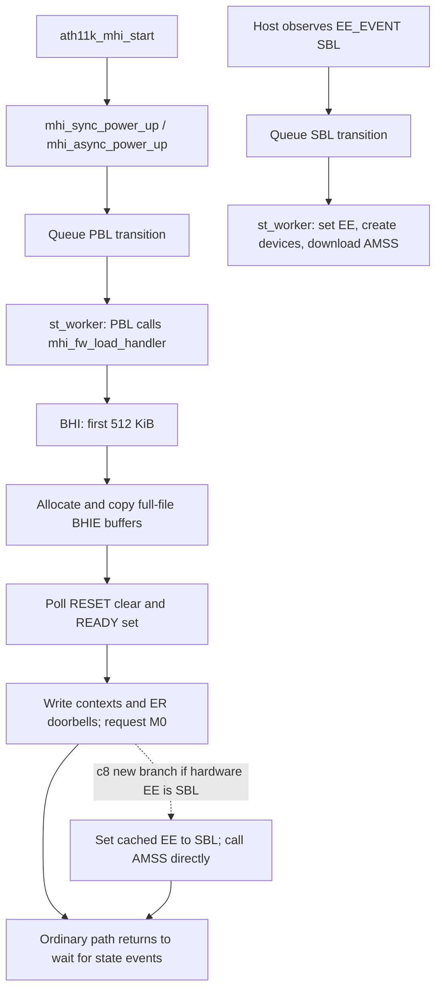

# MHI state machine: c7 observations and the held c8 path

Updated 2026-11-16 after the 15:12/15:18 review. **c8 is held: no build,
rebuild or boot is authorised by this note.** The image, manifest and compiled
source copies are retained. The former “proven deadlock” conclusion is
withdrawn; c7 supplies observations and c8 introduces a new execution path.

## 0. What c7 actually establishes

Capture: `E:/k60-work/evidence/usblog-20261116-122546/console.log`,
3,367 lines / 227,186 B, SpringBoard 128 lines, panic markers 0. At line 632:

```text
Pong MHI: timeout after 20000 ms ee=0 pm_state=2 exec_env=1 mhi_state=1 MHISTATUS=0x101 MHICTRL=0x200
```

| field | supported reading at this sample |
|---|---|
| `exec_env=1` | hardware `BHI_EXECENV` reports `MHI_EE_SBL` |
| `MHISTATUS=0x101` | hardware state READY (bits 15:8 = 1), READY bit set, SYSERR bit clear |
| `MHICTRL=0x200` | host requests M0 (bits 15:8 = 2); RESET bit 1 clear; this is not proof the device entered M0 |
| `ee=0` | cached host EE is PBL at timeout; no EE processing is observed in this capture |
| `pm_state=2` | **MHI_PM_POR = BIT(1)**, not MHI_PM_M0, which is BIT(2) = 4 |
| `-110` | `mhi_sync_power_up()` did not observe mission-mode EE before its 20 s timeout |

Enums/masks: pinned Linux `include/linux/mhi.h:123-158`,
`drivers/bus/mhi/common.h:111-115`,
`drivers/bus/mhi/host/internal.h:141-157`. The numeric PM value is a bitmask,
not the ordinal of the similarly named PM-state enumeration.

No `event type=`, `EE event execenv=` or AMSS/BHIE-entry print is captured.
This supports **no observed EE processing or AMSS-download entry**, not a
proof that firmware never emitted an event or that it can only wait for AMSS.
DMA/cache visibility, context programming, doorbells, the device M0 transition
and shim scheduling remain candidate causes. No observed SYSERR bit is not a
general device-health certificate. See [MSI-TOPOLOGY.md](MSI-TOPOLOGY.md) for
why a shim IRQ invocation does not prove hardware MSI delivery.

## 1. The ordinary FBC path and the added c8 branch

Unqualified source locations in this section are the pinned Linux
`drivers/bus/mhi/host/` files. Generated c8 locations are explicitly prefixed
`ath11k-c8/mhi/`; they are copies under
`/opt/k60/trees/k60build/wifi/ath11k-c8/`.



The c7 host path is `ath11k/mhi.c:446` → `pm.c:1277-1298` →
PBL worker (`pm.c:816-821`) → `boot.c:490` firmware handler:

| ordered host step | pinned source | evidence limit |
|---|---|---|
| Select FBC; send first `sbl_size=524288` bytes by BHI | `boot.c:556-583` | c7:618 reports load type 2, image bytes 524288, full-file bytes 5296128 |
| Allocate full-file BHIE table, then copy bytes into data buffers | `boot.c:596-603` | these are host operations, not proof of device DMA reads |
| Poll RESET clear, then READY set at 25 ms intervals | `pm.c:186-198` | c7:624/626/628; this handshake requires no IRQ |
| Set software PM to POR; initialise MMIO contexts | `pm.c:206-224` | PM POR is consistent with the timeout sample |
| Set ER write pointer to last element, ring ER doorbells, request M0 | `pm.c:236-251` | host writes do not establish device acceptance |
| Ordinary SBL event queues the SBL worker, which calls AMSS if FBC | `main.c:893-926`, `pm.c:823-836` | neither EE-processing nor AMSS entry was observed in c7 |

This order matters: the BHI transfer precedes table construction. The ELF
program-header count does not choose the BHIE byte-chunk count.

## 2. A host-visible ring pointer is not a device-read receipt

c7:608 prints `dev rp=0xa0001a00 host rp=0xfffffff9bb055a00`; three
`found no new events` samples follow at :610/:612/:620. The label `dev rp`
means the host read `er_ctxt->rp`; it does not identify who last wrote it.

`init.c:391-395` initially sets `ring->rp = ring->wp = ring->base` and
`er_ctxt->rp = er_ctxt->wp = er_ctxt->rbase`. READY later changes **wp**,
`*ring->ctxt_wp`, to the last element (`pm.c:239-246`), not rp. The old
description of rp as the wrap endpoint was wrong. Equal pointers establish
an empty ring in the host-visible samples; the unchanged initial value proves
neither that the device fetched its context nor that it never wrote memory.

The runtime replays registered IRQs: generated `lx_rt_pong.c:32,355,597`
initialises polling to 1, periodically sets registered lines pending, and
dispatches their handlers from `lx_pump()`. The MHI handler can therefore run
without any captured GIC-entry message. In the platform worker,
`drivers/PongWifi/PongWifiPlatform.cpp:690` jumps to `done` on start failure,
so the `MSI delivered` log in the success loop at :692 is unreachable for c7.
The failed path never dumps final numeric `msiEntries`/`msiArrivals`; neither
that unreachable log nor the shim handler establishes MSI arrival or its
absence. The distinct GIC-entry print at :646 was not observed in the capture.

## 3. Correct full-file BHIE arithmetic

`boot.c:368-441` uses `DIV_ROUND_UP(alloc_size, seg_len) + 1` buffers; the
extra final buffer holds the vector table. For the c7/c8 input:

| quantity | value |
|---|---|
| Full file | 5,296,128 B = `0x50d000` |
| Data chunk capacity | 524,288 B = `0x80000` |
| Data buffers / vector entries | `ceil(5296128 / 524288) = 11` |
| Data lengths | 10 full chunks + 53,248 B (`0xd000`) |
| Total `image_info->entries` | **12**, including vector-table buffer |
| Vector-table payload | 11 × 16 B = **176 B** (`bhi_vec_entry` is two `__le64`) |
| Last data vector index | 10 = `entries - 2`; vector-buffer index 11 = `entries - 1` |

The former `entries=11` expectation was an off-by-one mistake. The ELF32
header has 17 program headers/15 PT_LOAD records; those are unrelated to this
file-byte split. No second ELF at file offset `0x80000` means that FBC keeps
the full file; it does not invalidate FBC. [FIRMWARE.md §3.1](FIRMWARE.md)
contains the corrected file inspection. c6/c7 did not print actual entries.

## 4. c8 changes state execution and lacks download deduplication

Generated `ath11k-c8/mhi/boot.c:616-649` adds a path after READY succeeds:

```c
if (mhi_cntrl->fbc_download &&
    mhi_get_exec_env(mhi_cntrl) == MHI_EE_SBL) {
        /* pre-push register observations */
        mhi_cntrl->ee = MHI_EE_SBL;
        mhi_download_amss_image(mhi_cntrl); /* returned int is ignored */
        /* post-push register observations */
}
```

This is a **new state-machine execution path**, not string-only
instrumentation. It assigns cached EE and calls AMSS outside the ordinary
SBL transition. That assignment is not an in-progress/completed lock, and
no flag or queue cancellation prevents the original SBL branch from running.
The source log “with no EE event” is also stronger than its test: it tests
FBC and hardware SBL, not whether an SBL item is already queued. Source and
compiled copies stay unchanged during this review.

### 4.1 Actual cooperative scheduling

Generated `ath11k-c8/mhi/pm.c:809-811` splices the shared transition list
into a local list once per worker invocation. `pm.c:768-781` appends every
transition item and queues the same `st_worker`. Runtime
`lx_rt_pong.c:206-210` coalesces a queued **work item**, not its transition
list entries. Before running it, `lx_rt_pong.c:415-418` clears `queued` and
marks it running. `work_runnable()` at :92-104 prevents recursive execution
of the same work and enforces the ordered queue limit. At :419 a callback
that consumed the 2 ms pump budget ends that work-dispatch pass; shared-list
SBL processing can therefore occur after the outer waiter starts power-down.

```text
st_worker PBL -> fw_load_handler -> direct AMSS -> BHIE wait -> lx_pump
    IRQ/event processing may append SBL and queue st_worker again
    same running st_worker cannot recursively execute
    direct AMSS returns -> fw_load_handler returns -> PBL case completes
    SBL already in local snapshot: processed later in this invocation
    SBL added to shared list: processed by a later worker invocation
    either SBL case can call AMSS again when fbc_download remains true
```

| path | offline finding |
|---|---|
| Late/duplicate SBL | `pm.c:826-839` unconditionally assigns SBL, creates devices and calls AMSS when FBC; cached EE is not checked for deduplication |
| Nested BHIE wait | shim may process IRQ/event work, but the running state worker cannot recurse; the possible second AMSS call is **deferred and sequential** |
| Repeated READY item | `pm.c:851-853` calls only READY transition, not the proactive AMSS branch; another power-up/recovery caller can repeat it while POR. The event switch at `main.c:874-899` does not enqueue READY for a hardware READY event. Its return is ignored |
| Repeated PBL/firmware-handler entry | the proactive branch belongs here; it has no once-only guard either |
| Direct AMSS failure | `boot.c:705-714` attempts FW_DL_ERR and wakes waiters; the caller at :644 ignores the return, emits post-push/Wait and returns normally |
| Original SBL AMSS failure | `pm.c:837` also ignores the return; transition-list dispatch continues rather than aborting at that call |

A second AMSS **call** is not necessarily a second completed hardware
transfer. After FW_DL_ERR, `MHI_REG_ACCESS_VALID` still permits register
access (`internal.h:157-162`): a queued SBL can program TXVEC/doorbell before
the BHIE wait immediately returns `-EIO` on the error state
(`boot.c:219-255`). If the outer waiter first calls nongraceful power-down,
`pm.c:1230-1262` sets LD_ERR_FATAL, disables cached EE and flushes the worker;
a later AMSS call then fails the register-access guard. SBL already in the
worker's local snapshot can run before that worker returns. New event
processing rejects an error state (`main.c:830-831`), but this does not remove
transition items already queued. The execution order therefore matters.

An already-queued MISSION item is another conditional failure path:
`pm.c:406-429` can read hardware mission EE while FW_DL_ERR still permits
register access, assign cached EE and wake the outer waiter, then fail
`__mhi_device_get_sync()`. Its worker caller ignores that return. The outer
`mhi_sync_power_up()` at `pm.c:1293-1298` waits for mission EE **or** fatal PM,
but chooses its return value from cached EE alone. If mission EE becomes
visible before that final test, it can report success despite the PM error.
This is a source-level possibility, not an observed c7/c8 race.

These are reachable code paths, not a claim that c7 produced late SBL items.
An image that happened to reach AMSS would still not prove the duplicate
path absent or establish that WiFi channels/networking work.

BHIE completion also needs care on repeat submission. `boot.c:225,236-255`
generates a new sequence and rings the doorbell, but waits for nonzero status
and checks only XFER_COMPL. It neither explicitly clears status nor matches
the returned sequence to this submission. This leaves a software ambiguity
with stale completion status; actual device behaviour remains untested.

### 4.2 Protocol basis remains incomplete

Pinned `internal.h:32-35` describes FBC as BHI in PBL followed by BHIe in
SBL. `boot.c:210-255` checks `MHI_REG_ACCESS_VALID(pm_state)` and programs
TXVEC address/length/doorbell, then waits for BHIE transfer status. POR is
in the register-access mask (`internal.h:157`); this allows the host code to
write registers. It does **not** prove that QCA6490 accepts BHIE while its
MHISTATUS remains READY and the software PM state is POR. The ordinary
event-driven path and its timing cannot be replaced by that mask as protocol
authority. Conversely, this audit establishes no normative rule that BHIE in
READY is forbidden or that M0 is required first. READY transition requests
M0 but does not wait for acknowledgement; it assigns software dev_state=READY
before checking whether its POR transition succeeded (`pm.c:209-217,254`).
c7 timeout SBL also does not prove SBL was present at the earlier c8 branch.
No polling variant/c9 is authorised.

## 5. IOVA envelope and actual allocation audit are different checks

`ath11k/mhi.c:370-377` selects `[iova_start=0, iova_stop=dma_mask]` when
fixed-memory-region support is absent; [nw_pci.c](../../../drivers/PongWifi/ath11k/nw_pci.c):54
sets the mask to `0xffffffff`. This envelope includes the native arena.
`mhi_init_mmio()` writes the envelope into MHICTRLBASE/LIMIT and
MHIDATABASE/LIMIT, while **CCABAP/ECABAP/CRCBAP are independent explicit
context IOVAs** (`init.c:469-538`). A base of zero is not a physical-zero
context pointer or a structural mismatch.

For each actual allocation, the audit still needs `(IOVA, byte length)` and
an overflow-safe full-range check inside both the declared envelope and
the mapped arena. This includes channel/event/command contexts, every
channel/event/command ring, all 11 firmware data buffers, and the 176-byte
vector table (plus its allocated extent). Context lengths are
`sizeof(mhi_chan_ctxt) * max_chan`, `sizeof(mhi_event_ctxt) * total_ev_rings`
and `sizeof(mhi_cmd_ctxt) * NR_OF_CMD_RINGS` (`init.c:321-404`).

[PongWifiPlatform.cpp](../../../drivers/PongWifi/PongWifiPlatform.cpp):464-472
maps the MSI page at `[0xa0000000,0xa0001000)` and the 64 MiB arena at
`[0xa0001000,0xa4001000)`. `dmaAlloc()` (:529-538) bounds/alignment-checks
host allocations and returns `Iova + 4096 + offset`; `dmaMap()`/`dmaSync()`
(:541-542) also bound their ranges. Those source invariants do not supply
all live pointer/length values or prove the programmed register values match.
c7 has no complete allocation/register dump, so that runtime audit is open.

The arena uses `kIOMapWriteCombineCache` (:415-416); `dmaSync()` executes
`dsb sy` but no cache clean/invalidate. This leaves visibility as a hypothesis,
not a proven cache defect. Zero captured SMMU faults and unchanged initial
rp do not close it.

## 6. Source identity and the WiFi gate gap

The c8 manifest records checkout `/mnt/e/hackios/k60-wifi`, revision
`dd3154a716e89d0fbcc74058a3de705166fe1a29`, dirty files 0. The different
`k60-wifi-lead` checkout is not the generator used for this image. Offline
inspection retained source copies and per-file inventories under
`E:/k60-work/scratch/c8-provenance-review/`; its `REPORT.md`, `audit.json`
and two source-hash inventories record the full observations.

| identity link | observed evidence |
|---|---|
| Committed ath11k generator | Git blob `225b70de0540516c7942bc661f21896b8a47a48d`; SHA-256 `0bb0e9a1682b79bd0dc69cb12548789652494ea8dd78ac2a8efb991444e9630c`; worktree equals blob |
| Generated MHI sources | Committed literal replacements applied in memory to current Linux inputs reproduce complete c8 boot/pm/main files; every old fragment is unique |
| Compile inputs | 40 command records, with current source/object hashes and resolved symlink targets inventoried; database SHA-256 `bc2e8d502a7571c3197fa499850211718e430a0c054ca746eb8aa898c394635a` |
| ath11k archive | 733,064 B; SHA-256 `80b47cfde715240833613a48f0e1ccd2d4abefa3fb7686688900e77274ac1298` |
| Native archive | 12,071,440 B; SHA-256 `1236996adc8cd8c030ed0f194ae58448db7b01498a2e704036d1e2e62c65d95c`, equal to manifest |
| Archive relation | Both archives contain identical `PongAth11k-linked.o`, SHA-256 `7b5339cdb243ac423bf87911efcecfa848245404173b6d777e625d9a14ce013c`; archived payload equals standalone object plus four newline padding bytes |

These establish **present-file consistency**, not historical compile
attestation. The manifest does not hash the intermediate ath11k tree/archive
or immutable dependencies; some inputs are symlinks into mutable Linux
trees. Native firmware assembly is `__DATA,__const`, corroborating the
wrapper's transient T2 patch, but the exact applied native-builder source
hash was not retained before that patch was restored.

The retained c8 gate log at
`E:/k60-work/artifacts/wifi-20261116c8/logs/eight-step.log:2-4` says **build**
mode, six items: touch, gpu, storage, display, bootchain, battery; 36 checks.
Its SHA-256 `67efa084aaa6a417dc2fa4c86901d279595806e4fc6c7cef1a56dd4702d19317`
matches the manifest. The manifest's `eight_step_items="all"` is a default
label, not proof that WiFi was checked.

[eight-step-gate.py](../../../scripts/eight-step-gate.py):119 filters to
`status="active"` before either mode. WiFi is `parked` in
[EIGHT-STEPS.toml](../EIGHT-STEPS.toml):390-393. The environment selection
`K60_EIGHT_STEP_ITEMS` applies only in build mode (:125-134); **flash mode
also omits parked WiFi**, including its device prediction checks (:175-184).
A read-only WSL `--flash` rerun on 2026-11-16 passed 48 checks for the same six
items and confirmed this gap. It grants no WiFi clearance. No historical
c8 flash result selecting WiFi was found in the inspected artifact directory
or c8 wrapper scripts. The WiFi record still has the old verify evidence,
device `done=false` and no device-prediction table; it has no c8 path-specific
local validation. This review changes neither gate code nor hardware status.

## 7. Review disposition

Keep c8 and its manifest as evidence, **do not fly or rebuild it**. Before
any replacement path is approved, resolve duplicate SBL/READY scheduling,
failure propagation, and the protocol basis for starting BHIE in the
observed hardware/software states. A generic green gate or present-source
hash does not validate these execution paths.
